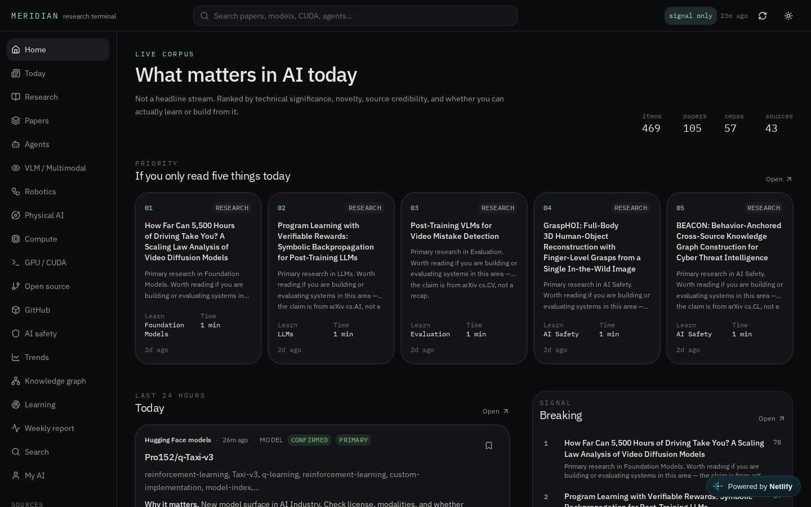

# Meridian

AI research intelligence terminal. It ranks what to read — papers, lab notes, engineering posts, and open-source artifacts — by **technical depth** rather than virality.

**Live:** [meridian-research-terminal.netlify.app](https://meridian-research-terminal.netlify.app)



## What it does

- Ingests official RSS/Atom feeds, the arXiv API, GitHub search/releases, and Hugging Face model listings
- Deduplicates coverage into clusters (one development, many sources)
- Classifies into a research taxonomy and scores importance
- Surfaces Today / This week / Deep reads / Breaking / Build this
- Knowledge graph, trends, weekly and monthly reports, model/org/source pages
- On-demand Grok briefings (“explain like an engineer”) when `XAI_API_KEY` is injected by the host
- Personal bookmarks and follows stored locally in the browser

It does **not** store full copyrighted articles. Records are metadata, URLs, abstracts/snippets, and generated summaries.

```
Sources (arXiv, RSS, GitHub, Hugging Face)
        ↓
  Normalize + dedupe into clusters
        ↓
  Taxonomy + importance score
        ↓
  Today / Deep reads / Trends / Graph
        ↓
  Optional briefing  →  local bookmarks
```

## Scoring

```
importance =
  0.25 technical depth
+ 0.20 novelty
+ 0.15 source credibility
+ 0.15 practical impact
+ 0.10 community adoption
+ 0.10 recency
+ 0.05 trend momentum
```

These weights are explicit product choices, not a published benchmark.

## Stack

TanStack Start, React, Tailwind. Postgres (Neon in production, PGLite in preview).

Data sources: `src/lib/intelligence/sources.ts`. Preferred order: official API → RSS → public JSON. Article-body scraping is not used.

## Development

```bash
npm install
npm run dev      # port 8080
npm run build
npm run typecheck
```

API keys are injected by the host (`DATABASE_URL`, `XAI_API_KEY`). Do not put secrets in the repo.

## Related

- [lattice](https://github.com/ahmaddroobi99/lattice) — visual field manual of the same research stack
- [qg-lada-lab](https://github.com/ahmaddroobi99/qg-lada-lab) — the scientific work this terminal is meant to serve
